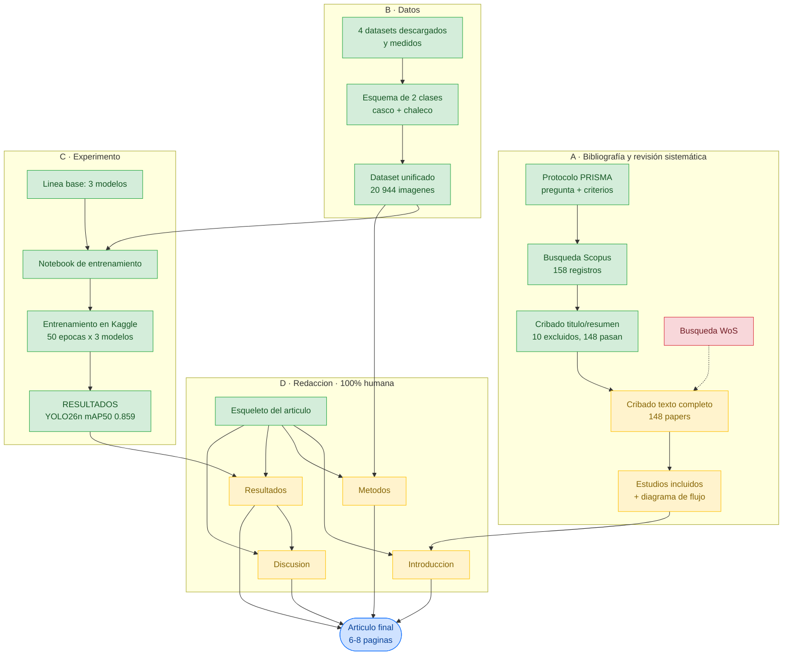

# 01 · Mapa general del proyecto

Los cuatro frentes de trabajo y cómo confluyen en el artículo.
**Actualizado: 2026-10-09**

| | |
|---|---|
| 🟩 verde | completado |
| 🟨 amarillo | pendiente |
| 🟥 rojo | bloqueado por algo externo |

## Lectura rápida

- **Los datos están resueltos.** El frente B está completo y alimenta tanto al experimento como a la sección de Métodos.
- **El experimento está resuelto**: YOLO26n alcanza mAP50 0,8592 y supera a la línea base.
- **La bibliografía va a medias**: el protocolo y Scopus están hechos; falta WoS y el cribado de texto completo.
- **La redacción solo tiene el esqueleto**, y depende de que lleguen resultados.
