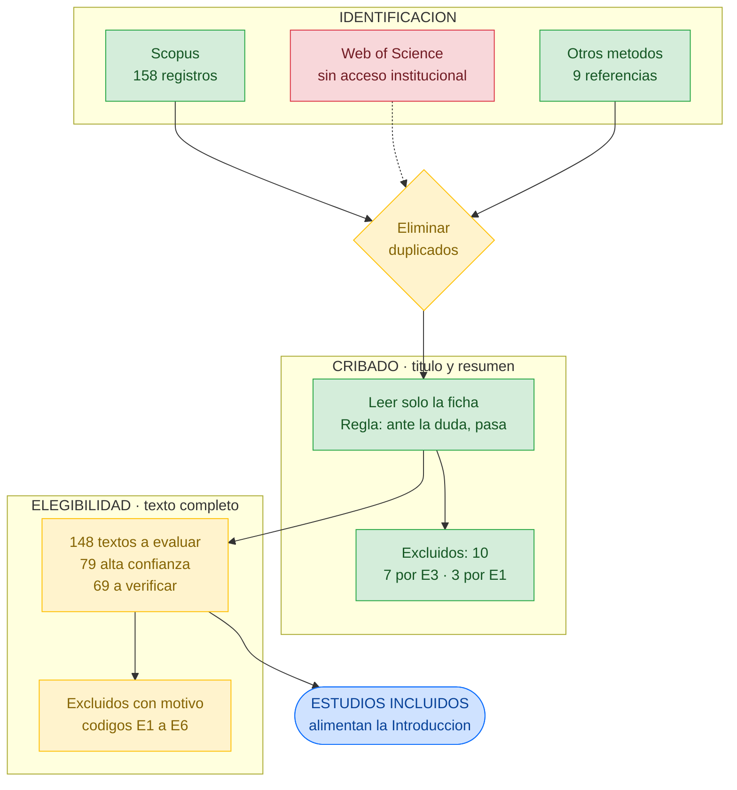
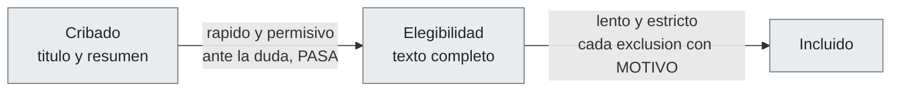
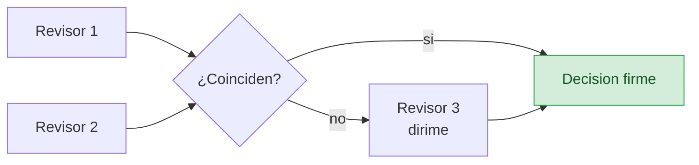

# 02 · Flujo de la revisión sistemática

Cómo funciona el embudo PRISMA y en qué punto estamos.
**Actualizado: 2026-10-09**

## Por qué dos etapas de lectura

Descartar en la primera etapa un estudio válido es un error **irreversible**; leer de más un
texto completo solo cuesta tiempo. Por eso la primera es permisiva y la segunda, estricta.

## Estado del embudo

| Casilla | Valor |
|---|---|
| Identificados en bases de datos | **158** · Scopus |
| Identificados por otros métodos | 9 |
| Duplicados eliminados | — *(al sumar WoS)* |
| Cribados por título y resumen | 158 |
| Excluidos en cribado | **10** |
| Buscados para recuperación | **148** |
| Evaluados en texto completo | — |
| Excluidos en texto completo, con motivo | — |
| **Estudios incluidos** | — |

## Quién hace qué

PRISMA exige **dos revisores independientes** y un tercero que resuelva discrepancias.
El equipo son tres personas, así que encaja exacto. Se reporta cuántas discrepancias hubo.
