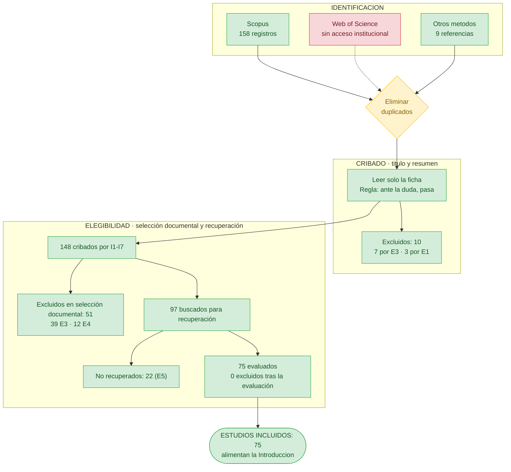
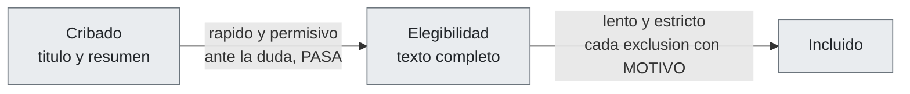
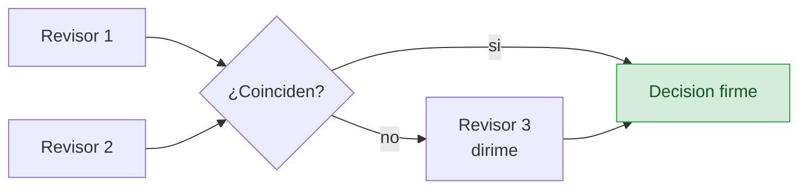

# 02 · Flujo de la revisión sistemática

Cómo funciona el embudo PRISMA y en qué punto estamos.
**Actualizado: 2026-11-02 (cribado cerrado)**

## Por qué dos etapas de lectura

Descartar en la primera etapa un estudio válido es un error **irreversible**; leer de más un
texto completo solo cuesta tiempo. Por eso la primera es permisiva y la segunda, estricta.

## Estado del embudo

| Casilla | Valor |
|---|---|
| Identificados en bases de datos | **158** · Scopus |
| Identificados por otros métodos | 9 |
| Duplicados eliminados | 0 (sin DOI repetidos; sin WoS no hubo deduplicación) |
| Cribados por título y resumen | 158 |
| Excluidos en cribado | **10** |
| Cribados por criterios I1-I7 (selección documental) | **148** |
| Excluidos en selección documental | **51** (39 E3, 12 E4) |
| Buscados para recuperación | **97** |
| No recuperados (E5) | **22** |
| Evaluados para elegibilidad | **75** |
| Excluidos tras la evaluación | 0 |
| **Estudios incluidos** | **75** |

## Quién hace qué

PRISMA exige **dos revisores independientes** y un tercero que resuelva discrepancias.
Se planteó con tres revisores (R1, R2, R3); en la práctica fueron asistentes de IA. Se reporta cuántas discrepancias hubo (28).
