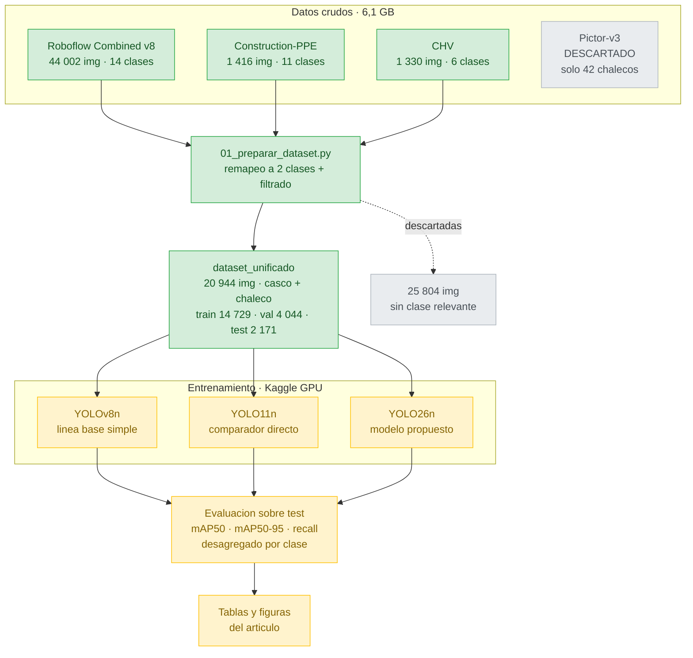
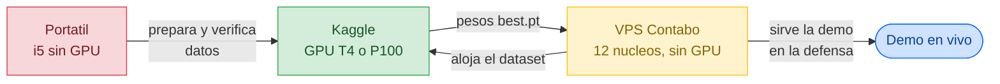

# 03 · Pipeline del experimento

Del dato crudo al resultado. **Actualizado: 2026-10-09**

## Dónde corre cada cosa

**Ninguna máquina local tiene GPU**, así que el entrenamiento va a Kaggle. El VPS no entrena,
pero resuelve el alojamiento del dataset y, más adelante, la demo para la defensa oral.

## El desbalance que arrastra el experimento

| Partición | Imágenes |  Casco | Chaleco |   Razón |
| ---------- | --------: | -----: | ------: | -------: |
| train      |    14 729 | 33 099 |   7 164 | 4,62 : 1 |
| val        |     4 044 |  9 512 |   1 629 | 5,84 : 1 |
| test       |     2 171 |  5 089 |   1 057 | 4,81 : 1 |

Hay casi **cinco cascos por cada chaleco**. Es esperable que las métricas de chaleco salgan
peores, y eso hay que reportarlo en Discusión, no ocultarlo.
