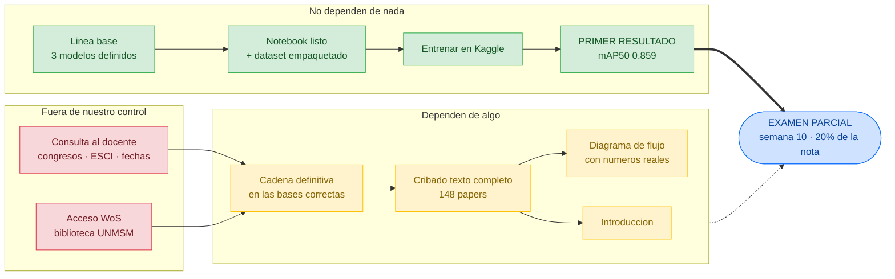

# 04 · Dependencias, bloqueos y ruta crítica

Qué espera a qué. **Actualizado: 2026-10-09**

## La ruta crítica

**El prototipo no depende de nada.** Ni del docente, ni de WoS, ni del cribado.
Se puede ejecutar hoy, y es lo único que la rúbrica no perdona en el parcial.

## La aritmética que lo justifica

| Escenario | Nota del parcial |
|---|---|
| Sin prototipo, todo lo demás excelente | **14 / 20** — aprueba raspando |
| Prototipo aceptable | 17,6 / 20 |
| Prototipo excelente | 20 / 20 |

Sin prototipo el techo es 14, y solo bordando los otros tres criterios.
Cualquier tropiezo adicional y se desaprueba.

## Pendientes, por urgencia

| # | Pendiente | Bloqueado por | Coste de resolverlo |
|---|---|---|---|
| **P1-P3** | Congresos · ESCI · fechas | consulta al docente | un mensaje |
| P4 | Acceso a WoS | biblioteca UNMSM | una gestión |
| P7 | Asignación de revisores | decisión del equipo | 5 minutos |

Las dos primeras son baratísimas y desbloquean mucho. Conviene resolverlas ya.
